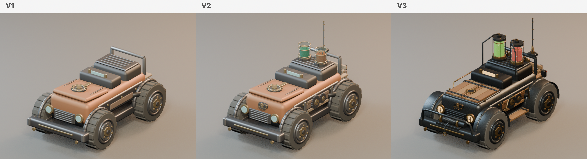
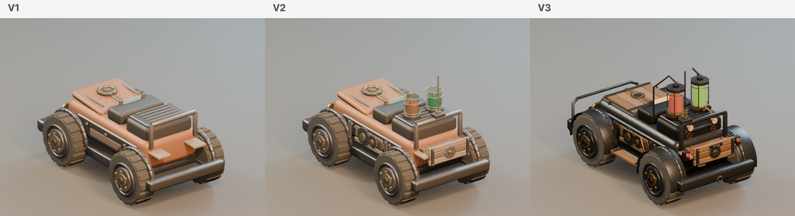

# RC car model comparison

The three Iron Teeth RC car models, rendered in Blender with the same camera angles and scale. V1, V2 and V3 appear from left to right. V3 is the model used by the mod.

## Front

## Back

V1 establishes the chassis and body. V2 adds details including the fluid cells, antenna and side gears. V3 adds a timber hood, darker steel body, enclosed cells, front winch and rear gauges.

Source files: [V1](../src/RcCar.Mod/Assets/IronTeethRcCar.blend), [V2](../src/RcCar.Mod/Assets/IronTeethRcCar_V2.blend), and [V3](../src/RcCar.Mod/Assets/IronTeethRcCar_V3.blend).
